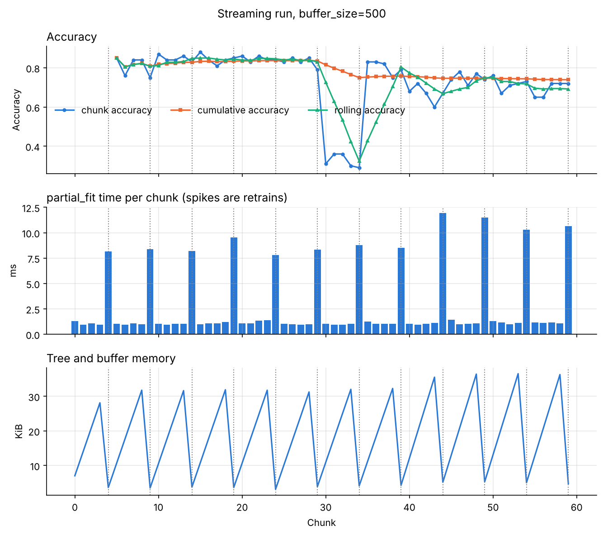
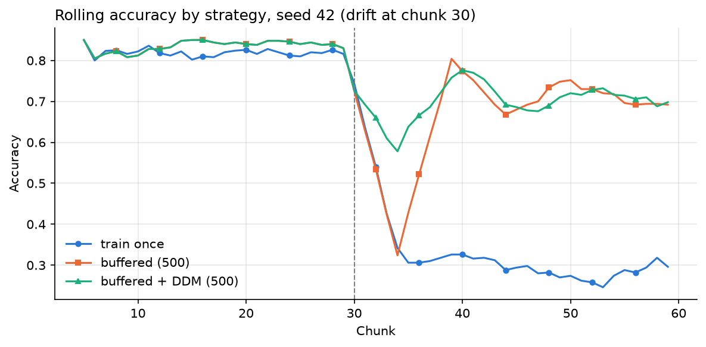

# NumCompute-Stream

Assignment 2.2, individual branch. This branch extends our group's
**NumCompute** package (Assignment 2.1, on `main`) with **`numcompute_stream`**:
streaming machine learning built around a buffered decision tree that I wrote
from scratch. It only uses NumPy and matplotlib.



`demo/stream_demo.ipynb` reads a sensor CSV with the package's own I/O, streams
it in chunks of 100 rows through `partial_fit`, logs every chunk and plots the
metrics over time.

## What it does

- Every part (I/O, statistics, preprocessing, metrics, model, pipeline) learns
  chunk by chunk with `partial_fit()` or `update()`.
- `DecisionTree(max_depth=5, buffer_size=500)` collects incoming chunks and
  retrains once the buffer holds `buffer_size` samples.
- `visualise` plots a metric over time, compares models and shows predictions
  against the ground truth.
- One extra beyond the brief: a DDM drift detector that triggers an early
  retrain.
- The points from the 2.1 feedback are fixed in `numcompute` and each has a
  test ([below](#response-to-the-21-feedback)).

## Installation

Python 3.9 or newer.

```bash
git clone https://github.com/siritummala21/NumCompute.git
cd NumCompute
git checkout individual
python -m venv .venv
source .venv/bin/activate          # Windows: .venv\Scripts\activate
python -m pip install -r requirements.txt
```

## Quick start

```python
import numpy as np
from numcompute_stream import (Pipeline, StandardScaler, DecisionTree, StreamTrainer,
                               chunk_stream)
from numcompute_stream import visualise as vis

X = np.random.default_rng(0).normal(size=(3000, 4))
y = (X[:, 0] + X[:, 1] > 0).astype(int)

def make_pipe(buffer_size):
    return Pipeline([("scale", StandardScaler()),
                     ("model", DecisionTree(max_depth=5, buffer_size=buffer_size))])

pipe = make_pipe(500)
for X_chunk, y_chunk in chunk_stream(X, y, chunk_size=100):
    pipe.partial_fit(X_chunk, y_chunk)
print(pipe.predict(X[:5]))

# test-then-train evaluation with a log of every chunk
trainer = StreamTrainer(make_pipe(500))
trainer.run(chunk_stream(X, y, chunk_size=100))
print(trainer.summary())

h = trainer.history_arrays()
vis.plot_metric_over_time(h["rolling_accuracy"], "Rolling accuracy", "Accuracy")
small = StreamTrainer(make_pipe(100))
small.run(chunk_stream(X, y, chunk_size=100))
vis.compare_models(small.history_arrays()["cumulative_accuracy"], h["cumulative_accuracy"],
                   labels=["buffer=100", "buffer=500"])
vis.plot_predictions_vs_ground_truth(trainer.last_truth, trainer.last_predictions)
```

## Project structure

```
NumCompute/                     (individual branch)
├── numcompute/                 group package (2.1) with the feedback fixes
├── numcompute_stream/
│   ├── io.py                   read_csv, iter_csv_chunks, chunk_stream, write_csv
│   ├── stats.py                RunningStats, StreamingQuantile, StreamingHistogram, update_stats
│   ├── preprocessing.py        StandardScaler, MinMaxScaler, SimpleImputer, OneHotEncoder
│   ├── metrics.py              accuracy, precision, recall, F1, confusion matrix, AUC
│   ├── tree.py                 DecisionTreeClassifier (vectorised CART, buffered retraining)
│   ├── pipeline.py             Pipeline, ColumnTransformer
│   ├── stream.py               StreamTrainer (test-then-train loop and logging)
│   ├── drift.py                DDM drift detector
│   ├── visualise.py            plots
│   └── base.py, _validation.py shared base classes and input checks
├── tests/                      group tests, test_stream_*.py, feedback tests
├── demo/
│   ├── stream_demo.ipynb       2.2 demo (outputs included)
│   ├── data/                   sensor_stream.csv and generate_dataset.py
│   ├── figures/                plots saved by the demo
│   └── quickstart.ipynb        group demo (2.1)
├── benchmark/
│   ├── stream_benchmark.py     loop vs vectorised, buffer_size, retraining strategy
│   ├── stream_results/         tables, plots and summary.json from the last run
│   └── run_benchmarks.py       group benchmarks (2.1)
├── DEBUGGING.md                bugs I found, the cause, the fix and the test for each
├── pyproject.toml
└── requirements.txt
```

## How it builds on numcompute

I extended the group's classes instead of starting again. The tree, the
trainer, DDM and the plots are new because the group package has nothing like
them.

| numcompute_stream | Built on (numcompute) | What I added for streaming |
|---|---|---|
| `TransformerMixin`, `BaseEstimator` | `pipeline.TransformerMixin`, `BaseEstimator` | `fit` = `reset` + one `partial_fit` |
| `StandardScaler`, `MinMaxScaler`, `SimpleImputer`, `OneHotEncoder` | the `preprocessing` classes (subclassed) | `partial_fit` with running statistics; new categories added as they appear |
| `Pipeline`, `ColumnTransformer` | `pipeline.Pipeline`, `ColumnTransformer` (subclassed) | `partial_fit` through every step |
| `RunningStats` | `stats.RunningStats` and its `merge()` | sliding window, missing-value counts |
| `StreamingHistogram` | `stats.histogram` | per-feature bins kept across chunks |
| `StreamingConfusionMatrix` and the metrics on it | `metrics.confusion_matrix` | counts add up across chunks; grows for new labels |
| `StreamingAUC` | `metrics.roc_auc_score` | keeps scores across chunks |
| `io` | `io.DEFAULT_MISSING` | categorical columns, lazy chunks |
| `benchmark/stream_benchmark.py` | `benchmarking.timeit` | streaming experiments |

`tests/test_stream_matches_numcompute.py` streams data in random-sized chunks
and checks that the result equals the matching `numcompute` function on the
whole data set.

## API

Every estimator works the same way: `partial_fit(X_chunk, y_chunk)` learns from
one chunk, `fit(X, y)` resets and learns from all of X, and `transform` /
`predict` use the current state. `X` has shape `(n_samples, n_features)` and
`y` has shape `(n_samples,)`. Wrong shapes, a changed number of columns and bad
hyper-parameters raise `ValueError` or `TypeError` with a message saying what
is wrong.

| Module | Main API | How it streams |
|---|---|---|
| `io` | `read_csv`, `iter_csv_chunks`, `chunk_stream`, `write_csv` | reads chunks lazily from disk; missing tokens become NaN or None |
| `stats` | `RunningStats`, `StreamingQuantile`, `StreamingHistogram`, `update_stats` | Chan's merge for mean and variance; reservoir sample for quantiles; optional window |
| `preprocessing` | `StandardScaler`, `MinMaxScaler`, `SimpleImputer` (`Imputer`), `OneHotEncoder` | running mean, std, min, max and fill values |
| `metrics` | `Accuracy`, `Precision`, `Recall`, `F1Score`, `StreamingConfusionMatrix`, `StreamingAUC`, `RollingMetric` | `update()`, `result()`, `reset()` |
| `tree` | `DecisionTreeClassifier` / `DecisionTree(max_depth, min_samples_split, min_samples_leaf, max_features, criterion, buffer_size)` | buffered retraining (below) |
| `pipeline` | `Pipeline`, `ColumnTransformer` | each step updates on the chunk, then transforms it |
| `stream` | `StreamTrainer.process_chunk`, `run`, `summary`, `to_csv` | logs chunk, cumulative and rolling accuracy, F1, retrains, times and memory |
| `drift` | `DDM` | watches the error rate per chunk |
| `visualise` | `plot_metric_over_time`, `compare_models`, `plot_predictions_vs_ground_truth`, `plot_confusion_matrix`, `plot_feature_importances`, `plot_stream_dashboard` | each takes `ax=`, `save_path=`, `show=` |

## How the buffered tree works

1. `partial_fit` adds the chunk to a buffer.
2. When the buffer holds at least `buffer_size` samples, the tree is retrained
   on the buffer and the buffer is cleared.
3. Between retrains `predict()` uses the latest tree. Before the first retrain
   it raises `NotFittedError`.
4. `flush()` retrains on a part-full buffer (used after a drift).

To find a split, each feature is sorted once, the labels are one-hot encoded in
that order and summed cumulatively. Row i of the result is the class counts of
the left child for a split after row i, and the right child is the total minus
that. So Gini or entropy for every threshold is one array expression and
`argmax` picks the best. Prediction moves all samples down the tree one level
at a time. `splitter="loop"` is the plain Python version used in the benchmark,
and a test checks both choose the same splits.

## Edge cases

| Case | What happens |
|---|---|
| NaN in features | statistics skip NaN; the tree scores splits on the non-missing rows and sends NaN rows to the larger child |
| Tiny values such as 1e-16 | a column is constant only if its max equals its min, so tiny but varying columns are still scaled |
| Ties | equal values are never split apart; lowest feature, then lowest threshold wins |
| Constant chunk or one class | scale is 1 and the transform gives 0; the tree is a single leaf |
| Empty chunk | ignored |
| New category or class mid-stream | one-hot adds a column at the end and the tree pads older buffered rows; the confusion matrix grows |
| Bad hyper-parameters | negative, bool, NaN and wrong types are rejected when the object is created |

## Benchmarks

```bash
python benchmark/stream_benchmark.py      # about 30 s
```

Results go to `benchmark/stream_results/` (CSV and Markdown tables, plots and
`summary.json` with the machine and library versions). Times are the best of
several runs after one warm-up, and the speed-up is loop time divided by
vectorised time, so it depends on the machine.

Accuracy does not depend on the machine (fixed seeds). Mean over three
drifting streams, chunks of 100, drift at chunk 30:

| buffer_size | Accuracy (mean ± std) | Retrains |
|---|---|---|
| 100 | 0.699 ± 0.005 | 60 |
| 250 | 0.735 ± 0.003 | 20 |
| 500 | 0.733 ± 0.006 | 12 |
| 1000 | 0.691 ± 0.006 | 6 |
| 2000 | 0.551 ± 0.004 | 3 |

| Strategy (buffer_size=500) | Accuracy |
|---|---|
| train once, never update | 0.548 ± 0.011 |
| buffered (as in the brief) | 0.733 ± 0.006 |
| buffered + DDM | 0.752 ± 0.006 |



## Running the tests

```bash
python -m pytest            # 218 tests
```

| Test file | Tests | What it checks |
|---|---|---|
| test_stream_io.py | 11 | CSV parsing, missing values, lazy chunks, bad files |
| test_stream_stats.py | 14 | running moments, window, quantiles, histograms |
| test_stream_preprocessing.py | 16 | scalers, imputer, one-hot encoder |
| test_stream_metrics.py | 13 | streamed metrics against batch values, AUC, rolling window |
| test_stream_tree.py | 26 | impurity, split search vs loop, buffering, edge cases, parameter checks |
| test_stream_pipeline.py | 7 | pipelines, mixed columns, new categories, fit-only steps |
| test_stream_trainer.py | 10 | test-then-train log, DDM, plots |
| test_stream_matches_numcompute.py | 8 | subclassing and equality with the numcompute functions |
| test_numcompute_feedback_fixes.py | 14 | the 2.1 feedback cases |
| group `test_*.py` | 99 | NumCompute (2.1) |

## Response to the 2.1 feedback

| Feedback | Fix | Test |
|---|---|---|
| `StandardScaler` treated `[1e-16, 2e-16, 3e-16]` as constant | constant only if max == min | `TestScalerTinyAndHugeValues` |
| Distance between 1e9 and 1e9 + 1 was 0 | direct differences instead of the Gram identity | `TestDistancesWithLargeCoordinates` |
| `grad` accepted a NaN step | `h`, `alpha0`, `tol` and `max_iter` are checked | `TestOptimiserStepValidation` |
| `fit(X)`-only transformers broke pipelines | `y` is passed only when `fit` accepts it | `TestFitOnlyTransformerCompatibility` |
| Tests did not check exact answers for edge cases | tests now assert the exact expected values | `test_numcompute_feedback_fixes.py`, `test_stream_*.py` |

`DEBUGGING.md` has the full list of bugs and fixes.
